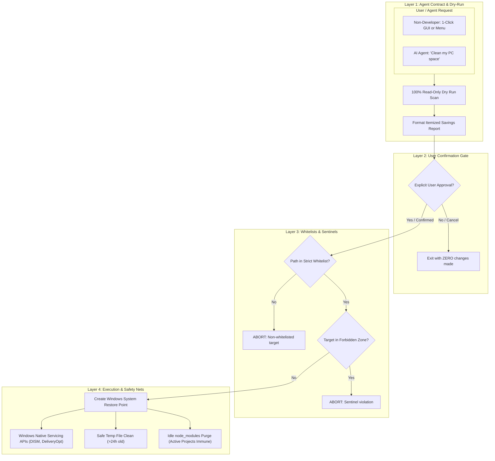

# Windows 11 PC Lean & Trim Skill (Ironclad Safety Edition)

This skill provides a **zero-risk, non-developer-accessible system maintenance suite** for Windows 11 Pro. It allows human users and AI agents (Gemini, Claude, Codex) to safely audit, trim, and configure permanent disk bloat prevention without risking personal files, source code, or system stability.

---

## 🔒 Mandatory Agent Behavioral Contract

Any AI agent executing this skill **MUST ALWAYS** follow this protocol:

1. **NO RAW DELETION COMMANDS**: The agent is strictly forbidden from executing ad-hoc terminal commands such as `Remove-Item`, `rd /s /q`, or `del` directly in chat. All operations must run through the vetted scripts in `scripts/`.
2. **DRY-RUN FIRST (100% READ-ONLY)**: The agent must ALWAYS run `Invoke-SafeCleanup.ps1` without `-Execute` first.
3. **MANDATORY USER CONFIRMATION GATE**: The agent must display the formatted Dry-Run Report in chat and explicitly ask the user for confirmation (`"Would you like me to proceed with this cleanup?"`). The agent must NEVER pass `-Execute` until the user explicitly responds with approval.
4. **FORBIDDEN ZONE ENFORCEMENT**: The script automatically aborts if any target touches personal folders (`Desktop`, `Documents`, `Downloads`, `Pictures`, `Videos`, `OneDrive`, `.git`, `.env*`, `src/`).

---

## Architecture: 4-Layer Safety Pipeline



---

## Available Scripts & Tools

| Script | Purpose | Elevation | Non-Dev Friendly |
| :--- | :--- | :--- | :--- |
| **`scripts/Start-Cleaner.bat`** | Self-elevating launcher with numbered menu and confirmation gates | Self-Elevating | ⭐⭐⭐ (1-Click) |
| **`scripts/Show-CleanerGui.ps1`** | Native Windows graphical interface with checkboxes & progress bar | Standard | ⭐⭐⭐ (Visual GUI) |
| **`scripts/Invoke-SafeCleanup.ps1`** | Core engine with `-DryRun` default switch, sentinels & whitelisting | Auto-Detect | Script Core |
| **`scripts/Audit-DiskSpace.ps1`** | Read-only diagnostic of volumes, VHDs, caches & pagefiles | Standard | Informational |
| **`scripts/Clean-IdleNodeModules.ps1`**| Prunes `node_modules` idle >14 days while protecting active work | Standard | Safe Dev Relief |

---

## Common Non-Developer Workflows

### 1. Launching the Visual GUI
Run from PowerShell or Command Prompt:
```cmd
start powershell -WindowStyle Hidden -ExecutionPolicy Bypass -File "%~dp0scripts\Show-CleanerGui.ps1"
```
1. Click **"1. Run Dry-Run Analysis"** to see recoverable gigabytes.
2. Review the preview text.
3. Check **"I have reviewed the Dry-Run Report..."**.
4. Click **"2. Start Safe Cleanup"**.

### 2. Running via AI Agent
When the user asks *"Clean my computer"* or *"Free up space on C drive"*:
```powershell
powershell -ExecutionPolicy Bypass -File "scripts/Invoke-SafeCleanup.ps1"
```
1. Show the resulting table to the user.
2. Ask: *"Dry-run completed. Reclaiming approximately X GB. Would you like me to proceed?"*
3. Once the user replies yes, run:
```powershell
powershell -ExecutionPolicy Bypass -File "scripts/Invoke-SafeCleanup.ps1" -Execute -NonInteractive
```
